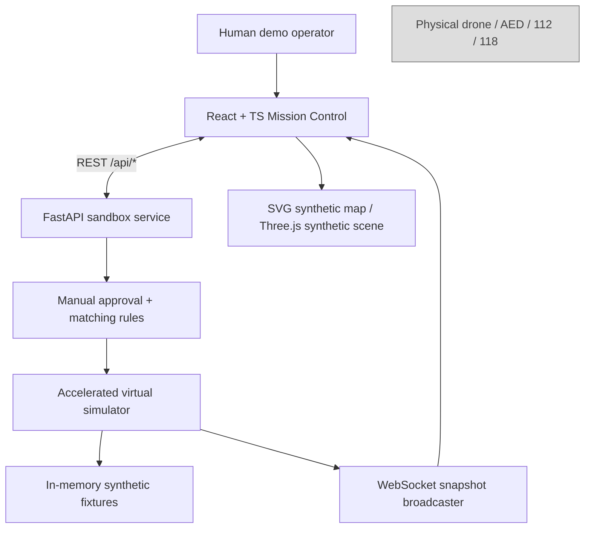
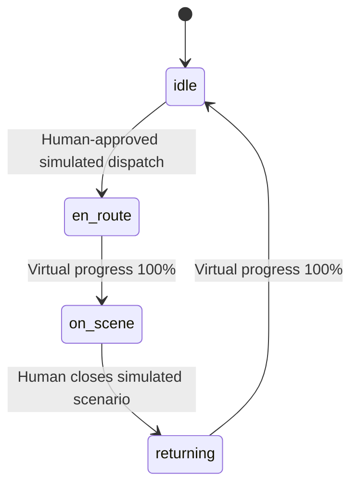

# AERES — technical architecture / MVP specification

## 1. Purpose and scope
Research-oriented ground software for visualizing **fictional** incidents and **virtual** drones in a controlled sandbox. The original AERES concept considers three potential future payload categories: AED, emergency-scene LED beacons and temperature-controlled medical deliveries. These are design concepts, not products certified for field operations.

### MVP system context

There is **no edge/hardware link** in the implementation. No real-world dispatching or emergency API exists.

## 2. MVP stack
| Layer | Current implementation | Later option (not implemented) |
|---|---|---|
| UI | React 18, TypeScript, Vite, CSS, Lucide icons | RBAC, audit viewer, incident scenarios |
| 2D | SVG schematic projection | Open-source GIS map tiles with licensing/attribution review |
| 3D | React Three Fiber / Three.js synthetic city | CesiumJS/geospatial digital twin with verified data rights |
| API | Python FastAPI, Pydantic 2 | Auth gateway, structured API versions |
| Telemetry | `/ws` snapshot each second | Sequenced events, reliable delivery, replay |
| State | In-memory deterministic data | PostgreSQL/PostGIS, Alembic migrations |
| AI | No live AI implemented | Advisory ranking only, transparent scoring, human sign-off |
| Real aircraft | Not present | Separate aviation-licensed project with independent safety case |

## 3. Simulated domain model
- **Drone**: ID, name, payload type, virtual status, battery estimate, virtual speed, position, base.
- **Incident**: ID, category, priority, synthetic location, status.
- **Mission**: ID, references to drone/incident, state, virtual travel duration, virtual progress.
- **Event**: timestamp, message, severity classification.

State machine:

Incidents move `pending → assigned → on_scene → resolved`; completing a mission does not turn a real event into resolved.

## 4. Core interfaces
- `GET /api/health` — health + `SIMULATION_ONLY` flag.
- `GET /api/snapshot` — single full snapshot.
- `POST /api/dispatch` — `{incident_id, drone_id, operator_confirmed:true}`; validates virtual battery, matching payload, state and explicit confirmation.
- `POST /api/resolve/{incident_id}` — transitions virtual on-scene incident to resolved and starts virtual return.
- `POST /api/reset` — clears virtual missions and restores synthetic seed state.
- `WS /ws` — full state snapshots once per second, including virtual progress updates.

The demo is intentionally unauthenticated and must remain **local only**. API contracts are not suited for production dispatch.

## 5. Dispatch logic and safeguards
1. Human clicks dispatch for a particular synthetic incident.
2. UI displays explicit confirmation naming the incident/drone and warning no real aircraft is involved.
3. FastAPI requires `operator_confirmed=true` and checks matching payload, idle status and virtual battery >=30%.
4. Service creates one simulated mission; its position is interpolated linearly and advanced by a **15x virtual clock**, not a real flight prediction model.
5. On arrival, human may close the incident; virtual vehicle returns to its base.

Current ETA is geometrically estimated using haversine distance and **invented speeds**; it excludes weather, airspace and flight physics. Never use in operational decision-making.

## 6. Target future (concept only)
- **Edge:** certified drone platform plus appropriate industrial autopilot, GNSS/RTK and validated redundancy, with approved payload attachment.
- **Dock:** weather-protected charge/monitoring system with remote diagnostics, access control and maintenance operations.
- **Communications:** authenticated/tamper-evident telemetry, multi-link redundancy and carefully tested lost-link behavior; safety controls cannot depend on a single cloud websocket.
- **Control center:** hazard-aware dispatch, verified airspace layers, human-in-the-loop permissions, high availability and audit.
- **Integrations:** coordination through formally agreed channels with emergency responders. Do not assume an available public 112/118 dispatch API.
- **Database:** PostgreSQL/PostGIS, strict partition of any personal/medical data, retention and authorization policies.
- **AI:** advisory classification or ranking only; independent testing, robustness evaluation and human responsibility.

## 7. Safety engineering and regulatory path
No blanket EASA/ENAC BVLOS authorization, medical compliance, spectrum licensing or public authority integration is implied by a simulator. Prior to **any** real trial: determine relevant operations category, perform a complete operation-specific risk assessment, coordinate with authorities, confirm airspace access, select trained/authorized pilots/operators and establish emergency procedures; evaluate the actual AED as a medical device, handling and user interface; obtain privacy and security review; document maintenance and evidence of reliability. Partner with recognized emergency organizations rather than running a self-activated medical response network.

## 8. Observability and failure scenarios
Production acceptance criteria must include connectivity loss, corrupt telemetry, payload securing, battery/charging faults, dynamic geofencing, adverse weather, third-party injury/property risk, unauthorized dispatch and incident false positives. These are **future engineering obligations**, not features implemented by the demo.
